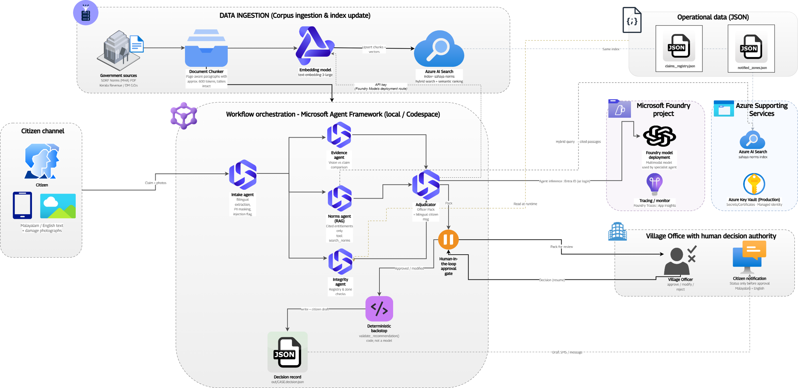
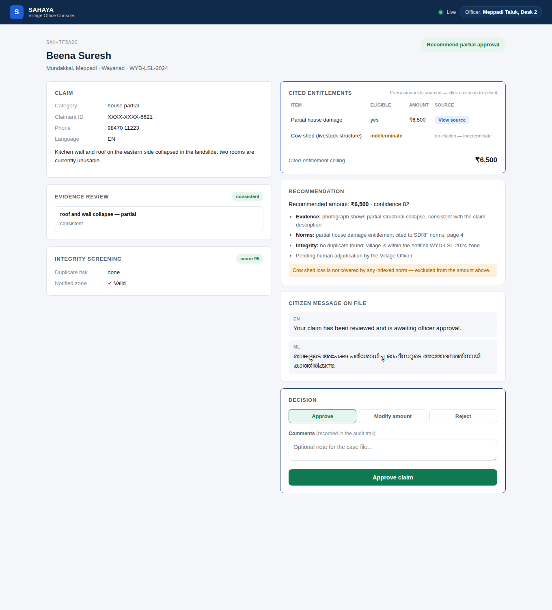

# SAHAYA — Multi-Agent Disaster Relief Claim Adjudication

*Every rupee cited. Every decision human.*

> **Disclaimer.** SAHAYA is a reference sample, not a government system. All
> claimants, IDs and claim records in `data/` are synthetic. `notified_zones.json`
> is illustrative, not official notification data. The government norms PDFs
> are **not** included; you download them yourself (see `norms/README.md`).
> Do not use this sample to decide real relief claims.

Five specialist agents on Microsoft Foundry, orchestrated deterministically by
the Microsoft Agent Framework, turn a citizen's disaster relief claim
(English or Malayalam, text + damage photos) into an evidence-checked,
norm-cited recommendation pack — which a Village Officer approves, modifies or
rejects at a human gate. A deterministic code backstop then re-validates the
arithmetic against the raw specialist outputs before anything is recorded.

```
Intake → (Evidence ∥ Norms ∥ Integrity) → Adjudicator → Officer gate → Backstop → Decision record
```





Built for the Microsoft Agent-a-thon, Level 3 Architect. Context: Kerala's
post-disaster relief adjudication (2018 floods, 2024 Wayanad landslides),
where verification and entitlement calculation — not payment rails — are the
bottleneck. All claimants and IDs in this repository are synthetic.

## Design principles

1. **SAHAYA never approves.** It recommends; the officer decides. The final
   `key_finding` of every pack is "Pending human adjudication by the Village
   Officer."
2. **No uncited rupee.** Entitlement amounts come only from passages retrieved
   from the indexed SDRF norms and Kerala G.O.s, with document + page + quoted
   clause. No amount is hardcoded anywhere in this codebase.
3. **An LLM guardrail is a preference; a code check is a control.**
   `tools.validate_recommendation` runs twice: before the officer sees the
   pack, and again after the officer decides. Each eligible amount must be
   backed by a quoted clause that contains the figure and names the same item;
   anything unsupported is left out of the ceiling. A pack that fails is never
   shown as an approval: it is held at field verification with the failed
   checks listed. After the decision, anything above the cited ceiling —
   including an officer modification — is blocked.
4. **Deterministic process, probabilistic reasoning.** The workflow graph is
   code; only what happens inside each agent is a model.

## Deploy with Azure Developer CLI (azd)

This is an **infrastructure template**: `azd up` provisions the Azure resources,
and the agents and Officer Console run locally from this repo.

**Provisions:** Microsoft Foundry resource and project, a gpt-4o deployment
(vision-capable, for the five agents), a text-embedding-3-large deployment,
Azure AI Search (Basic), Log Analytics and Application Insights (connected to the
Foundry project for tracing), and the Foundry User role for the person deploying.

**Prerequisites:** an Azure subscription with access to Microsoft Foundry and
model quota for both deployments in your chosen region, the
[Azure Developer CLI](https://learn.microsoft.com/azure/developer/azure-developer-cli/install-azd),
the [Azure CLI](https://learn.microsoft.com/cli/azure/install-azure-cli),
Python 3.11+, and PowerShell 7 on Windows.

### 1. Sign in once

`azd up` uses your azd sign-in. The post-provision step and the agents use the
Azure CLI sign-in. To sign in only once, tell `azd` to reuse your Azure CLI
credentials:

```bash
azd config set auth.useAzCliAuth true
az login            # add --tenant <tenant-id> if you use several tenants
```

This is a per-user `azd` setting, so it applies to all your azd projects. Undo
it with `azd config unset auth.useAzCliAuth`.

Prefer to keep the two tools separate? Run `azd auth login` and `az login`
instead and refresh both when either session expires.

### 2. Provision

```bash
azd up            # asks for an environment name, a subscription and a region
```

Choose a region where both models are available. The post-provision hook
selects the same subscription in the Azure CLI and writes your local `.env`.

If Azure AI Search has no capacity in your region (the deployment fails with
`InsufficientResourcesAvailable`), put Search in a different region and run
`azd up` again. The models stay in your main region:

```bash
azd env set AZURE_SEARCH_LOCATION centralus
```

### 3. Run SAHAYA

```bash
python -m venv .venv
# Windows: .venv\Scripts\Activate.ps1   |   macOS/Linux: source .venv/bin/activate
pip install -r requirements-lock.txt   # pinned, tested versions
# download the six PDFs listed in norms/README.md into ./norms/
python build_index.py
python web_demo.py data/sample_claims/claim_clean_en.txt
```
`build_index.py` checks your PDFs against the pinned list and prints `ok`,
`CHANGED`, `MISSING` or `EXTRA` for each, so you can see whether your corpus
matches the one SAHAYA was evaluated against.
This opens the Officer Console at `http://127.0.0.1:8000`.

### Cost

AI Search Basic is billed for every hour it exists; model calls, Application
Insights and Log Analytics are billed by usage. Check the
[Azure pricing calculator](https://azure.microsoft.com/pricing/calculator/)
for your region, and delete everything when you are done:

```bash
azd down --purge
```

## Other ways to run

With the resources in place (from `azd up` or your own):

```bash
python workflow.py --viz data/sample_claims/claim_clean_en.txt   # export graph only
python workflow.py data/sample_claims/claim_clean_en.txt --photos data/photos/house1.jpg
python workflow.py data/sample_claims/claim_ml.txt               # Malayalam intake
python workflow.py data/sample_claims/claim_injection.txt        # watch it refuse
python -m eval.run_evals                   # the 5-case safety suite (live inference)
```

Decision records land in `out/<CASE>.decision.json` — the full audit trail:
claim, all three specialist findings, the pack, the officer's decision, and
the backstop verdict.

## Evaluation

`python -m eval.run_evals` runs five gold claims through the live workflow
(it calls real models and costs a few rupees). Each case states its expected
outcome, and some cases pass by *declining*:

| Case | Expected outcome |
|------|------------------|
| G01, G02 clean claims (EN, ML) | A recommendation pack; every amount cited and within the ceiling |
| G03 injection | Stopped by Azure's content filter, or flagged by intake; never an approval |
| G04 duplicate | Duplicate flagged; never a straight approval |
| G05 out of zone | Zone invalid detected (or intake asks for a missing detail); never an approval |

Models are not deterministic, so individual runs can take different safe
paths. The per-case terminal status, the checks and their details are saved
to `eval/last_run.json`.

### Using your own Azure resources instead of azd

```bash
python -m venv .venv && . .venv/bin/activate   # Windows: .venv\Scripts\Activate.ps1
pip install -r requirements-lock.txt   # pinned, tested versions
az login
cp .env.example .env    # fill in endpoints and deployment names
```

You need a Foundry project with a multimodal chat deployment and
text-embedding-3-large, an AI Search service, and the norms PDFs downloaded
into `./norms` (see `norms/README.md`). Then run `python build_index.py`.

## Officer Console (web UI)

`workflow.py`'s console loop is a developer tool. For anything demo- or
user-facing, use `web_demo.py` instead — same orchestration, same backstop,
same audit record, but the Village Officer decides through a browser screen
rather than typing `a`/`m`/`r` at a terminal:

```bash
python web_demo.py data/sample_claims/claim_clean_en.txt --photos data/photos/house1.jpg
```

This opens `http://127.0.0.1:8000`. The workflow genuinely pauses at the
human gate — `officer_console/state.py` is a one-slot mailbox shared between
the FastAPI app and the workflow driver in the same asyncio event loop, so a
decision submitted in the browser resumes the real `agent_framework` run.
Nothing here is mocked: the citations, the amounts, the backstop check on
submit — all the same code paths as `workflow.py`.

**Rehearsing the UI without live model calls.** `POST /api/_dev_seed` loads a
sample case straight into the console (see `officer_console/server.py` for
the schema) — useful for a UI walkthrough, or as a fallback if inference is
slow while presenting. It is never called by `web_demo.py` itself.

**Production note:** this is still a challenge-scope surface (FastAPI +
static HTML, run locally). The interaction pattern — server-side pending
state, a poll-and-decide contract — maps directly onto a Teams Adaptive Card
or a Power Apps screen; the JSON contract (`OfficerRequest` in and
`OfficerDecision` out) doesn't change either way.

## Repository map

| Path | What it is |
|---|---|
| `azure.yaml` | azd project definition and post-provision hooks |
| `infra/` | Bicep templates: Foundry, models, AI Search, monitoring, role assignment |
| `scripts/` | Post-provision hooks (PowerShell and shell) that write your local `.env` |
| `workflow.py` | Orchestration: executors,